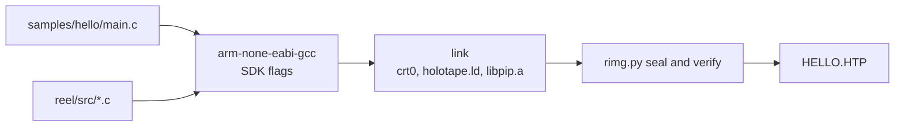

# Build

## Tools

The same tools as Pip-OS, see Pip-OS's [BUILD.md](https://github.com/RobCo-Industries/Pip-OS/blob/5f891e75ac0894beec1d4e9d8cb37c00ec0fbf3e/docs/BUILD.md#tools):

- GNU Make and a POSIX shell.
- `arm-none-eabi-gcc` and binutils, for the tapes and the launcher ROM.
- A host C compiler, `cc`, for the host tests.
- Python 3, standard library only, for the build and the checks.
- For the QEMU tests: `qemu-system-arm`, `qemu-system-aarch64` for `raspi3b`, and mtools. `make test-target` makes a `.venv` and installs pytest and Pillow into it from PyPI, from RobCo-Core's `tests/requirements.txt`.

CI runs everything in the suite's `robco-ci` container, which has all of these.

## Fetch the sources

```sh
git submodule update --init --recursive
```

Pip-OS is the only submodule, in `external/pip-os`. RobCo-Core comes inside it, in `external/pip-os/external/robco-core`. Reel never pins RobCo-Core on its own, so the two cannot drift apart.

## Targets

| Command | What it does |
|---|---|
| `make` | Builds the sample tapes into `build/samples/`. Today that is `build/samples/hello/HELLO.HTP`. |
| `make CI=1` | The same, with warnings as errors, as CI builds. |
| `make test-host` | The licence check, the tool tests, the pin checks and the host unit tests. |
| `make test-target BOARD=raspi2b` | The QEMU tests on one board. `BOARD=all`, the default, runs the four boards. |
| `make test` | `test-host`, then `test-target`. |
| `make check-licence` | Fails on a GNU licence notice, an SPDX identifier other than MIT, or a C file without an MIT SPDX first line. |
| `make check-pins` | The CI workflow and the doc links name the commits the submodules hold. |
| `make clean` | Removes `build/`. |

## How a tape is built

A sample's `Makefile` sets the tape's name and sources, includes `reel/reel.mk`, then the Pip-OS SDK's [`pipos-app.mk`](https://github.com/RobCo-Industries/Pip-OS/blob/5f891e75ac0894beec1d4e9d8cb37c00ec0fbf3e/sdk/pipos-app.mk). `reel.mk` adds Reel's sources to `SRCS` and its headers to the include path. The SDK compiles everything with its own flags: ARMv6, soft float, freestanding. It links with `crt0`, `holotape.ld` and `libpip.a`, seals the image as `ROBCO78` with RobCo-Core's `rimg.py` and verifies it.



Reel is compiled into the tape from its sources. There is no `libreel.a` yet, because `pipos-app.mk` has no setting for an extra archive.

The hello tape is 3716 bytes with Pip-OS `5f891e7` and `arm-none-eabi-gcc` 15.2.0. Another compiler gives another size.
