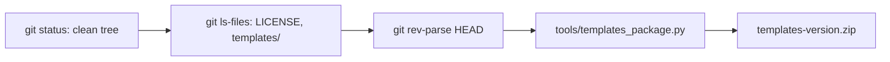

# The templates package

`make templates-package` writes `build/templates-<version>.zip`, the `templates` package that `robco new` reads. RobCo-Core's [SDK_PACKAGE.md](https://github.com/RobCo-Industries/RobCo-Core/blob/712db81c9c804d4a8ede1f866ea764c0c6299844/docs/spec/SDK_PACKAGE.md#the-templates-package) fixes its layout and its manifest. The version comes from `REEL_VERSION_MAJOR`, `MINOR` and `PATCH` in `reel/include/reel/reel.h`, so `0.1.0` today.

No package is published yet. A release needs the owner's agreement first.

## What the archive holds

| Path | Source |
|---|---|
| `sdk.json` | The manifest: `name`, `version`, `built_from`, `formats`, `requires`, `licences` and `files`. No `abi`, `tools` or `firmware`. |
| `templates.json` | The list of templates, written by `tools/templates_package.py` |
| `holotape-c/` | The files of `templates/holotape-c/` |
| `LICENSES/MIT.txt` | This repository's `LICENSE` |

`formats` is `project`, `scenario` and `templates`, each `1`. `licences` is MIT for every path. `templates.json` marks a file `substitute` when `tools/fill_template.py` replaces its tokens, so the package and Reel's own tests fill a template the same way.

## What the target does

1. It stops when the work tree has a change or an untracked file, since `built_from` names the commit.
2. Only the files git tracks go in. Each git call stops the build with git's own message when it fails, such as "detected dubious ownership" in a container that does not own the checkout.
3. Before it writes, the tool searches every file, `sdk.json` included, for the checkout's path, the build folder, `$HOME`, the host name and the user name in its home folder forms. A hit refuses the package.
4. The archive is written with the zip writer of Pip-OS's `tools/sdk_package.py`: `sdk.json` first, then the files in byte order, stored, dated 1980-01-01 00:00, mode 0644. Two builds of one commit give the same SHA-256.

`tests/tools/test_templates_package.py` checks the layout against the spec's `templates.json`, the equal bytes, each refusal and a failing `git`.

## The checker

`make templates-package-check` runs Pip-OS's `tools/sdk_package.py check` on the archive, as it stands. That checker knows only the `pipos` package. It refuses the templates package for its name, for the missing `abi`, `tools` and `firmware`, for its `formats`, and for a layout that is not the `pipos` layout. It finds no broken entry name, no unlisted file, no wrong hash and no machine path. So the target fails today, and CI does not run it.

## The workflow

`.github/workflows/templates-package.yml` runs on every pull request, on `main` and on a tag `templates-*`:

- `package` runs the tool tests, builds the package twice, compares the SHA-256 and uploads the archive as the `templates-package` artifact. On a tag it checks that the tag names the archive it built.
- `publish` runs only when `github.event_name` is `push` and the ref starts with `refs/tags/templates-`. It alone holds `contents: write`. It attaches the archive to a release of that tag.
