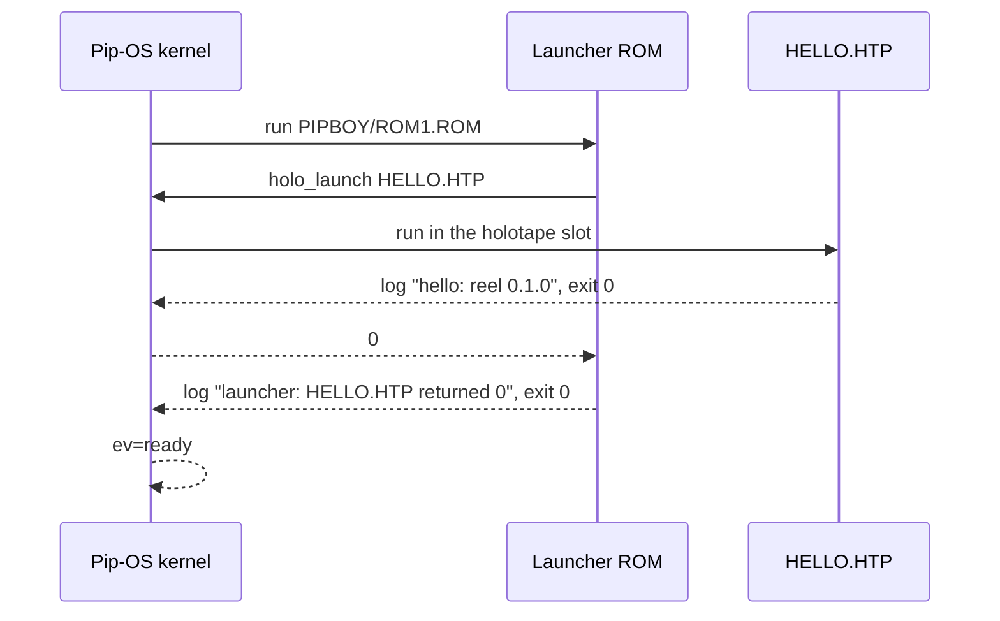

# Testing

## Host tests

`make test-host` runs, in order:

1. `tools/check_licence.py`: every file is MIT, see [CONTRIBUTING.md](../CONTRIBUTING.md#licence). It does not look inside `external/`.
2. The tests of that script, in `tests/tools/`, with `unittest`.
3. `make check-pins`, then `tests/host/check_pins_test.sh`, which proves that a stale pin in a copy of the repository fails the check.
4. The C tests, `tests/host/test_*.c`, built for the host with RobCo-Core's [`mk/host.mk`](https://github.com/RobCo-Industries/RobCo-Core/blob/712db81c9c804d4a8ede1f866ea764c0c6299844/mk/host.mk). They use the CI's flags: `-std=gnu11 -Wall -Wextra -Werror`, with AddressSanitizer and UndefinedBehaviorSanitizer when the compiler has them. When the host compiler is clang, `host.mk` also compiles every file with the cross GCC to catch GCC-only warnings.

Each C test file is one binary that links Reel's sources and RobCo-Core's pure library. Tests use RobCo-Core's `rc_test.h`.

## QEMU tests

`make test-target BOARD=<board>` builds the hello tape, the launcher ROM, the Pip-OS kernel and a card, then runs `tests/test_*.py` with pytest on that board. The boards are `raspi0`, `raspi1ap`, `raspi2b` and `raspi3b`. The harness is RobCo-Core's, loaded through Pip-OS's `pipos_testing` package, see Pip-OS's [TESTING.md](https://github.com/RobCo-Industries/Pip-OS/blob/ada823c96320f3744d2f8064d1a690d2920d048d/docs/TESTING.md#testing-a-rom-project).

A tape needs a ROM to start it. The test uses its own launcher ROM in `tests/launcher/`. The Makefile builds it once per tape, with `TAPE` set to the tape's file name. It calls `holo_launch(TAPE, "")` once, logs what the call returned and exits. The SDK's `hello` example ROM can launch tapes too, but it waits for a key press, so the test would have to drive its menu.

`tests/test_hello.py` waits for `ev=ready`, then checks the tape's line against the version in `reel/include/reel/reel.h`, the launcher's line, the ROM's exit status and that no exception marker was printed.

### The template test

`tests/test_template.py` boots the tape that `make template` built. It writes its own card in the test's temporary folder: `/PIPBOY/PIPOS.CFG` with the text of the spec's simulator card, the launcher built with `TAPE=HOLOC.HTP`, and the tape in `/PIPBOY/HOLO/`. The card has no `PIPOS.IMG` and no `config.txt`, since QEMU reads neither. Then it:

1. Waits for the tape's line `tape: ready`.
2. Compares a capture of the screen with `templates/holotape-c/tests/golden/start/ready.png`, pixel for pixel. Every board compares with the same image.
3. Presses SELECT and waits for `ev=ready`.
4. Checks that the launcher logged exit status 0 and that no exception marker was printed.

To write the golden image again, run the test once on one board with `REEL_UPDATE_GOLDEN=1`, look at the image, then run all four boards without it.

QEMU and the tests run on Linux and macOS. They are not checked on real hardware.
